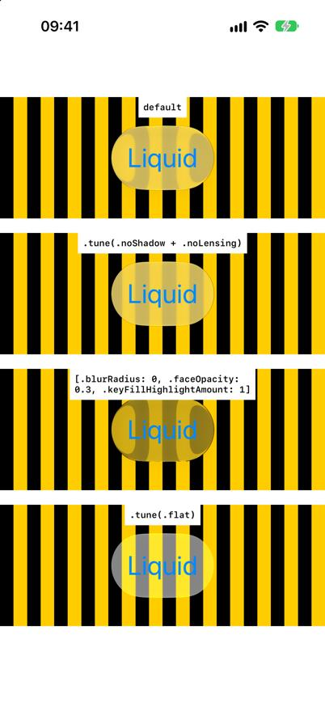
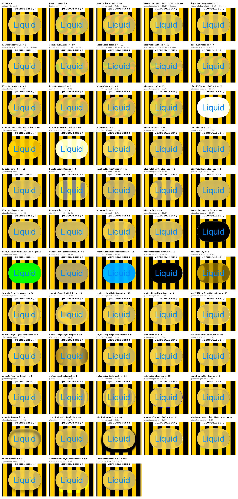
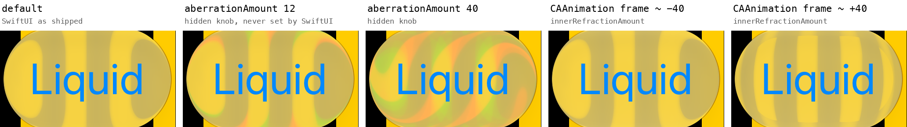

# Glass tuning

Liquid Glass is drawn by a Core Animation filter of type `glassBackground` on a
`CABackdropLayer` under SwiftUI's `SDFLayer`. Its ~70 inputs – shadow, refraction (lensing), blur,
face colour matrix, key-light highlight, bleed, HDR headroom – are the real parameters. These
modifiers write, read and probe them on the system's own glass.

## `.tune(_:)` — iOS

```swift
Button("Liquid") {}.glassEffect().tune(.noShadow + .noLensing)
Button("Liquid") {}.glassEffect().tune([.blurRadius: 0, .faceOpacity: 0.3, .keyFillHighlightAmount: 1])
Button("Liquid") {}.glassEffect().tune(.flat)
```



- **Typed keys:** `GlassInput` (generated in `BoneGlassInputs.swift`) lists the 69 inputs SwiftUI
  sets, with the values iOS 27 used, plus 5 hidden ones `.probeGlass` found live:
  `.aberrationAmount` (chromatic dispersion), `.aberrationHeight/Offset/Angle`,
  `.bleedColorMatrixFillColor`.
- **Presets**, combined with `+` (right side wins): `.noShadow`, `.noLensing`, `.noBlur`,
  `.noHighlight`, `.noBleed`, `.flat`, `.aberration`.
- **Values:** plain literals (`0`, `0.4`, `true`), `.color(UIColor)`, `.size(w, h)`;
  `.raw(["inputSomethingNew": 1])` for any other key – prefix it to reach another filter of the
  glass: `.raw(["vibrantColorMatrix.inputColorMatrix": BoneColorMatrix.value(BoneColorMatrix.invert)])`.
- `log: "tune.txt"` writes what changed (before → after).
- `.tune(excludeShadow: true, contentLensing: false)` still works as a shortcut for
  `.tune(.noShadow + .noLensing)`.

**How it works:** Bone finds every layer carrying a `glassBackground` filter and writes the inputs
through the key path `filters.<name>.<input>`. SwiftUI rebuilds the filter on updates (hover,
press, state changes), so the values are re-applied a few times per second.

### `.tune(file:)`

```swift
Button("Liquid") {}.glassEffect().tune(file: "glass-panel.json")
```

Loads overrides from JSON – the format the [inspector](inspector.md) saves. In the simulator the
file is `<project>/captures/<name>` and is re-read whenever it changes: edit it on the Mac and watch
the glass, no rebuild. Keys are `GlassInput` case names or Core Animation keys; non-numbers are
tagged: `{"color": [r, g, b, a]}`, `{"size": [w, h]}`, `{"matrix": [20 numbers]}`.

## `.dumpGlass(_:only:after:)` — iOS

```swift
Button("Liquid") {}.glassEffect().dumpGlass("glass.txt")                                  // all inputs
Button("Liquid") {}.glassEffect().dumpGlass("glass.txt", only: [.blurRadius, .shadowOpacity])
Button("Liquid") {}.glassEffect().tune(.noShadow).dumpGlass("tuned.txt", only: [.shadowOpacity])
```

Writes the current inputs of the glass filter, with the same `GlassInput` keys as `.tune`:

```
blurRadius  (inputBlurRadius)                       = 5
faceColorMatrixFillColor  (inputFaceColorMatrixFillColor) = CGColor(1.000, 1.000, 1.000, 0.200)
shadowOffset  (inputShadowOffset)                   = size(0.0, 8.0)
```

Without `only:` it writes every input, plus the other filters on the glass layers (e.g.
`vibrantColorMatrix` with its 4×5 colour matrix). Put it after `.tune` to verify a tuning.
`after:` (default 1.5 s) waits for the glass to render.

## Shader parameters: `.dumpGlass(full: true)` and `.dumpShaders(_:)`

`.dumpGlass("glass-full.txt", full: true)` adds the glass element's layer tree and the **glass
shaders' own parameters**, all in one file. `.dumpShaders("shaders.txt", matching: "glass")` writes
just the shader part, for any QuartzCore shader family (`"blur"`, `"vibrant"`, …).

Bone loads QuartzCore's `default.metallib` with Metal (228 functions on iOS 27, 36 glass) and
reflects each glass shader by building a render pipeline with QuartzCore's own vertex function (the
reflection-only API is not implemented in the simulator). One variant per family is reflected
(`reflectAll: true` for all, slower); it takes ~0.5 s. You get every buffer, texture and uniform
struct the shader reads – field, byte offset, type – and which filter input feeds it:

```
-- S1: 63 fields, 320 bytes · bound as u in glass_background_all_lpf.u
     16      inner_refraction_amount     float     ← innerRefractionAmount
     20      inner_refraction_inv_height float     ← 1 / innerRefractionHeight
     80      face_cm0                    half4     ← faceColorMatrix{Black, FillColor, MaxLuma, …} (derived)
     160     blur_alpha0                 float     ← blurOpacity0
     312     aberration_dir              float2    ← aberrationAngle (as a direction)
     32      refraction_threshold0       float     –        (no input – set by the render server)
```

On **macOS** `.dumpShaders` works the same way (`captures/mac-shaders.txt`: 240 functions, 36 glass,
the same structs on an M1 Pro).

Five structs on iOS 27: `glassBackground` (63 fields), its SDF variant (66), the shared extension
block (`u_ext`: `preserve_hue`, `stroke_mode`, `highlight_extension`, …), and `glassForeground` (13)
with its SDF variant (16).

## On watchOS and macOS

`.dumpGlass(_:only:after:)` and `.tune(_:log:)` work on Apple Watch and on the Mac too, with the
same types and presets. One engine serves both (`BoneGlassRuntime.swift`); `BoneWatch.swift` and
`BoneMac.swift` decide which windows to walk and which glass lies in the modified view:

```swift
Button("Glass") {}.buttonStyle(.glass).dumpGlass("watch-glass.txt")
Button("Glass") {}.buttonStyle(.glass)
    .tune(.flat + [.blurRadius: 0, .faceOpacity: 0.6], log: "watch-tune.txt")
```

watchOS has no public UIKit, but the watch's glass is the iPhone's – a `CABackdropLayer` with a
`glassBackground` filter under SwiftUI's `SDFLayer` – so Bone reaches it through the Objective-C
runtime and the same key paths. Both act on the glass inside the modified view's frame; `.tune`
re-applies 8× a second. On macOS 27 the same tuning changed 10 inputs of a `.glassEffect()` panel
(`captures/mac-tune.txt`) while the stock button beside it kept its values (`captures/mac-glass.txt`).
`.tune(file:)` is iOS-only for now.

A glass button on the watchOS 27 simulator (`captures/watch-glass.txt`), next to the iOS 27 demo
button (`captures/glass-default.txt`; a larger button, and refraction scales with the shape):

| Input | watchOS 27 | iOS 27 |
|---|---|---|
| `blurRadius` | 5 | 5 |
| `faceOpacity` | 1 | 1 |
| `innerRefractionAmount` | −26.25 | −39.833 |
| `bleedAmount` | 18.375 | 27.883 |
| `shadowOpacity` | 0.0625 | 0.0988 |

`captures/watch-tune.txt` logs the tuning (10 inputs changed, e.g. `blurRadius 5 → 0`,
`faceOpacity 1 → 0.6`); `captures/watch-tuned.txt` is the dump after it.

## `.probeGlass(_:after:)` — which inputs are live, iOS

```swift
Button("Liquid") {}.glassEffect().probeGlass("glass-probe.txt")
```

Finds out which filter inputs actually change the rendered glass. For every input name the SDK
exports (`kCAFilterInput…`, 136 on iOS 27, listed in `BoneFilterInputNames.swift`) and every key
already on the filter, it sets test values (numbers 0, 1, 10, 50, −10; toggles; red/green; two
colour matrices), captures the composited screen and counts changed pixels around the glass. Inputs
that changed nothing are tried again with the live hidden inputs switched on (pass 2) – some only
modulate another one.

It writes `glass-probe.txt` (report), `glass-probe.json` and `glass-probe.png` (a contact sheet of
every live input), and takes ~3 min for both filters of a glass button. Use a structured backdrop:
over a flat colour, refraction, blur and aberration are invisible.



### Results (iOS 27 simulator)

Glass button over black/yellow stripes, two runs, identical verdicts for all 270 inputs:



- **Hidden but live** (never set by SwiftUI): `inputAberrationAmount` (chromatic dispersion),
  `inputBleedColorMatrixFillColor` (a bleed tint); on `vibrantColorMatrix`: `inputBackdropAware`,
  `inputClampPreserveHue` (tiny).
- **Only with aberration on:** `inputAberrationHeight`, `inputAberrationOffset`, `inputAberrationAngle`.
- 44 of the inputs SwiftUI sets change the image; the rest of the 136 names do nothing on this
  filter (they belong to other Core Animation filters).

### On macOS

`.probeGlass` runs on the Mac too (`BoneMac.swift`), capturing the glass region with ScreenCaptureKit –
the app needs **Screen Recording** permission (System Settings ▸ Privacy & Security). macOS 27, glass
button over stripes (`captures/mac-glass-probe.*`, 252 inputs, 3.5 min): the same hidden aberration
inputs as on iOS, plus two the iOS run did not flag – `inputBackColor0` and `inputBackColor1` change
the rendering (88% and 38% of pixels), though SwiftUI never sets them. On watchOS the prober is not
available: its capture, flush and drawing are built on APIs the watchOS SDK hides.

### How it measures

- `drawHierarchy` does not reproduce Liquid Glass; UIKit's private `_UICreateScreenUIImage` matches
  `simctl io screenshot` pixel for pixel.
- Right after `CATransaction.flush()` the screen sometimes still shows the previous commit, so every
  capture waits two frames and must agree with the next one (runs differ by ≤ 10 px of 201 075).
- Inputs are restored in place – `setValue(nil, forKeyPath:)` removes a key. Putting a filter object
  back takes the render server about a frame, so that is only the fallback; every restore is checked
  against the baseline.
