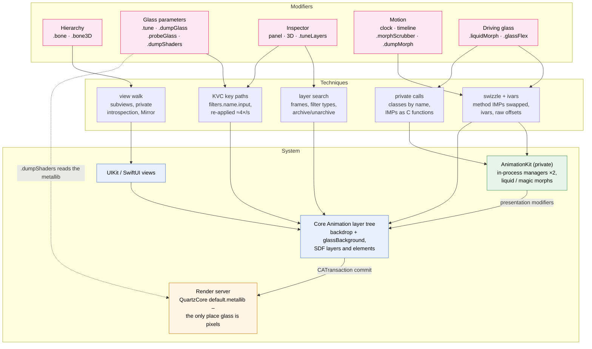
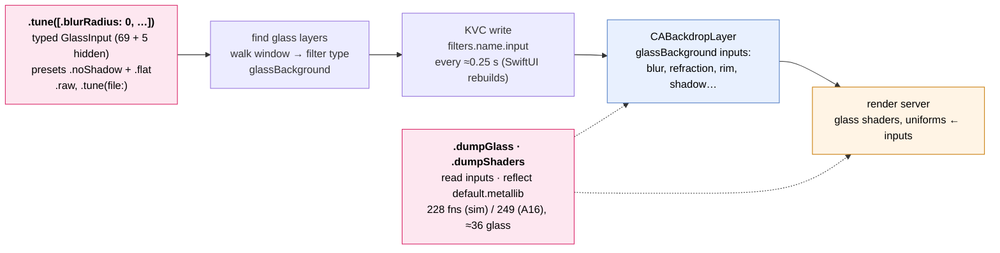
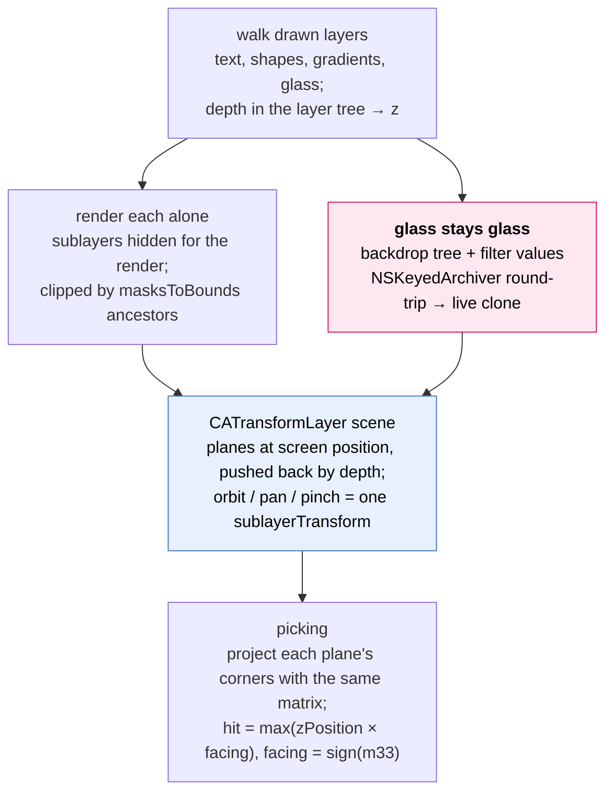
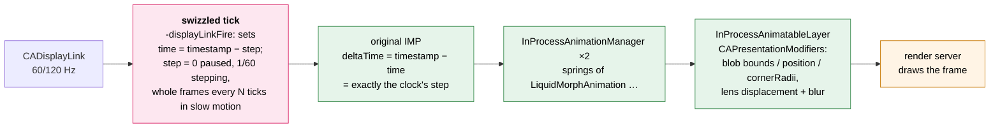
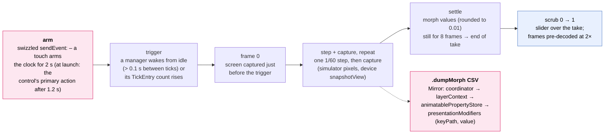
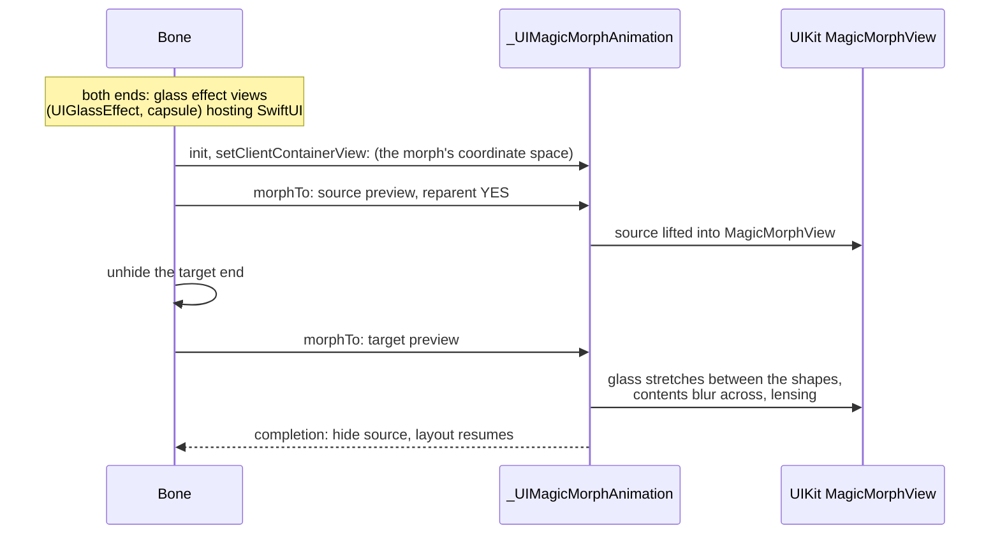
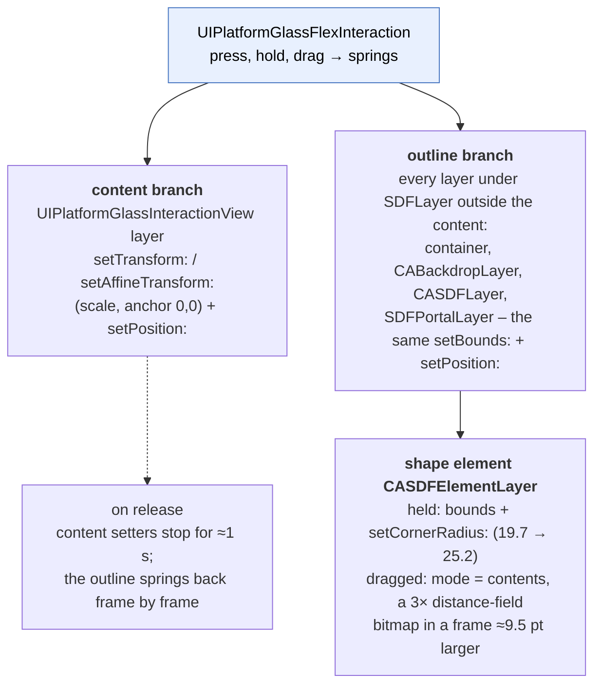
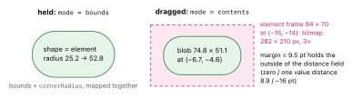
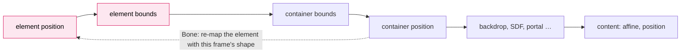

# Bone – internals and novelty

How it works – at the level of layers, ivars and setters – and what is new.

*iOS 27 (24A437) · iPhone 14 Pro (A16) + simulator · 11 October 2026.* Also as a
[PDF](bone-internals.pdf) ([Typst source](bone-internals.typ)).

> **Research only.** Everything below uses private classes, selectors, ivars and Core Animation keys,
> found and verified by measurement on iOS 27. Names and behaviour change between OS releases. Never
> ship any of it in an App Store build.

Bone is a set of SwiftUI modifiers that look *underneath* SwiftUI: the UIKit views and Core Animation
layers SwiftUI renders into, the private Liquid Glass filter and its shaders, and the private
AnimationKit engine that animates the glass. It started as a hierarchy dumper (`.bone(into:)`) and
grew into a toolkit that reads, tunes, freezes, records and re-drives the system's own Liquid Glass –
in place, on the real glass, not on a reimplementation.

**Contents**

1. [Feature map](#1-feature-map)
2. [The toolbox – techniques everything is built from](#2-the-toolbox--techniques-everything-is-built-from)
3. [Hierarchy dumps](#3-hierarchy-dumps)
4. [Liquid Glass parameters](#4-liquid-glass-parameters)
5. [Inspector and the 3D exploded view](#5-inspector-and-the-3d-exploded-view)
6. [Motion: the AnimationKit clock](#6-motion-the-animationkit-clock)
7. [Driving Apple's morph on our own views](#7-driving-apples-morph-on-our-own-views-liquidmorph)
8. [Glass stretch in depth](#8-glass-stretch-glassflexstretchfollow-in-depth)
9. [Measuring on the phone](#9-measuring-on-the-phone)
10. [Novelty – what is new, and how sure](#10-novelty--what-is-new-and-how-sure)

## 1 Feature map

| Modifier / tool | What it does | How (one line) |
|---|---|---|
| `.bone(into:)` | UIKit view tree behind a SwiftUI view, overlay + file | hosts the view in a `UIHostingController`, walks `subviews`; `_ivarDescription`, `recursiveDescription`, `Mirror` → JSON |
| `.bone3D()` · `.bone3DFrom(_:)` | the tree as 3D slabs (visionOS) | same walk → RealityKit entities |
| `.tune(_:)` | override any Liquid Glass parameter | KVC key paths `filters.<name>.<input>` on the backdrop layer, re-applied |
| `.dumpGlass(_:)` | all ≈70 glass inputs with values | reads the filter objects' input keys |
| `.probeGlass(_:)` | which inputs really change the pixels | 136 SDK input names × test values, composited-screen pixel diff |
| `.dumpShaders(_:)` | the glass shaders' own uniforms | QuartzCore `default.metallib` + Metal pipeline reflection |
| `.boneInspector()` | tap any glass or layer, edit live on sliders | overlay window, hit-testing by layer frames, same KVC writes |
| 3D exploded view | every drawn layer as a plane, live glass in 3D | `CATransformLayer` planes, glass cloned with `NSKeyedArchiver` |
| `.tuneLayers(_:)` · `.dumpLayers` | filters/blend/transform on the layers of any view | targets layer kinds (`CGDrawingLayer`, `ColorShapeLayer`…) |
| `BoneAnimationClock` | pause, step, slow motion of the glass morphs | swizzled `-displayLinkFire:`, rewritten ivar `time` |
| `.morphTimeline()` · `.morphScrubber()` | record a morph, scrub it 0 → 1 | clock steps + capture per frame; trigger from touch + manager wake-up |
| `.dumpMorph(_:)` | the morph's animated values per frame, CSV | `Mirror` down to `CAPresentationModifier`s |
| `.liquidMorph(to:isPresented:)` | Apple's glass morph between any two views | `_UIMagicMorphAnimation` `morphTo:` with targeted previews |
| `.glassFlex(stretch:follow:)` | the glass button's press/drag stretch × N | swizzled `CALayer` setters, content + outline + shape element mapped |

### Architecture



## 2 The toolbox – techniques everything is built from

### Anchor views

Almost every modifier is `background(SomeRepresentable(...))`: a zero-size `UIViewRepresentable`
whose `UIView` lands in the same window as the modified content. Its frame in window coordinates
marks **the area the modifier applies to** (glass inside it is tuned, flexed or probed); its `window`
is the entry point for layer searches. `.glassFlex` keeps its anchors in a weak `NSHashTable` so a
hook can ask “is this layer inside a `.glassFlex` view?”.

### Finding the glass

Liquid Glass is not a view. On iOS 27 a glass shape is a small layer tree under SwiftUI's `SDFLayer`
(a Swift class – `NSClassFromString("SDFLayer")` does **not** find it, matching by
`String(describing:)` does):

```
SDFLayer                          host – resting size, e.g. 61×39
├─ _UIInheritedView layer
│  └─ UIPlatformGlassInteractionView   content: label, glow
└─ CALayer                        container = the shape's frame
   ├─ CABackdropLayer             glassBackground (~70 inputs),
   │  │                           vibrantColorMatrix
   │  └─ CASDFLayer "@0"          CASDFOutputEffect
   │     └─ CALayer
   │        └─ CASDFElementLayer  THE shape: bounds + radius,
   │                              or a distance-field bitmap
   ├─ SDFPortalLayer              the content inside the glass
   └─ CASDFLayer                  rim highlight, via a portal
```

Bone finds glass by walking a window's layer tree for layers whose `filters`/`backgroundFilters`
contain a filter of type `glassBackground` (`BoneGlassLayers.glassLayers`).

### Writing private filter inputs

A Core Animation filter input is reachable by key path on the layer that owns the filter:
`layer.setValue(v, forKeyPath: "filters.glassBackground.inputBlurRadius")`. `setValue(nil, …)`
removes the input again (the filter falls back to its default). SwiftUI rebuilds the filter on hover,
press and state changes, so tuned values are re-applied a few times per second.

### Swizzling and ivars

Two private engines are steered by replacing one Objective-C method each:
`method_setImplementation(m, imp_implementationWithBlock(block))`, with the original IMP kept as a
`@convention(c)` function pointer (`unsafeBitCast(method_getImplementation(m), …)`) and called from
the block. A generic `@convention(c)` type is not representable, so there is one concrete hook per
argument type (`CGRect`, `CGPoint`, `CATransform3D`, `CGAffineTransform`, `CGFloat`). Swift ivars of
private classes are reached with `class_getInstanceVariable` + raw offsets, and Swift private storage
(no ivars exposed) with `Mirror`.

### Seeing the result

| Where | Method |
|---|---|
| simulator | `_UICreateScreenUIImage` – matches `simctl` screenshots, glass included. After a `CATransaction.flush()` wait 2 frames and require two identical captures (the first can still show the previous commit). |
| device, in-app | pixels of the composited screen read back black; `UIScreen.snapshotView` keeps the glass as a live view (scrubbable, not saveable). `drawHierarchy` draws **no** glass anywhere. |
| device, from the Mac | `xcrun devicectl device capture screenshot` – the real composited screen (≈1.3 s per frame; black while the display is off). |

## 3 Hierarchy dumps

`.bone(into:)` places a `UIViewRepresentable` container, waits for layout, hosts the content in a
`UIHostingController` (or takes the window's root controller with `fromRoot: true`) and walks
`subviews` recursively. Per view it records class, superclass, layer and sublayers – the **brief
dump** (`output.txt`, depth encoded by leading `-`). With iOS 27 it also runs `BoneCapture`:

- private UIKit introspection: `-_ivarDescription` (all ivars incl. SwiftUI host state),
  `-recursiveDescription` (LLDB's `po view`), `-_autolayoutTrace`;
- `Mirror` of the SwiftUI root value **and** of the `_UIHostingView` – Swift stored properties that
  no ivar list shows: the ViewGraph, renderer, preference bridges;
- a `Codable` node tree → `<name>_capture.json` / `.txt`.

On visionOS `.bone3D()` turns the same walk into RealityKit slabs (`HierarchyBuilder`), and
`.bone3DFrom(_:)` rebuilds the graph from a brief dump made on another OS – the basis of the
cross-OS diffing.

## 4 Liquid Glass parameters



**`.probeGlass`** answers “which inputs are live?” empirically. For every input name the SDK exports
(136 `kCAFilterInput…` constants extracted from `QuartzCore.tbd`) plus every key already on the
filter, it sets a few test values, captures the composited screen and counts the pixels that changed
around the glass. Inputs that changed nothing are tried again with the live hidden ones switched on,
because some only modulate another (an aberration height needs an amount). Result on iOS 27: SwiftUI
never sets `inputAberrationAmount`, `inputBleedColorMatrixFillColor` (and the vibrant filter's
`inputBackdropAware`, `inputClampPreserveHue`), yet they render.

**`.dumpShaders`** loads QuartzCore's own `default.metallib` with Metal and reflects the glass
fragment functions. The reflection-only API is missing in the simulator, so each fragment is paired
with QuartzCore's **own** vertex function (`variable_blur_vert_lpf`, `sdf_filter_vert_lpf`) in a
render pipeline and reflected from there; vertex functions must be specialised, or Metal aborts. Each
uniform field is matched to the filter input that feeds it by name
(`inner_refraction_amount ← innerRefractionAmount`).

## 5 Inspector and the 3D exploded view

`.boneInspector()` adds an overlay `UIWindow` (the pink drop). A tap is resolved against layer
frames, not views – on iOS 27 text is a bare `CGDrawingLayer`, an SF Symbol a `ColorShapeLayer`, a
gradient a `GradientLayer`, none with a `UIView`. Glass opens its filter inputs (slider, typed value,
toggle, colour, size, 4×5 colour matrix; hidden inputs first, in purple), anything else its `CALayer`
(opacity, corners, border, shadow, 3D transform, blend mode, filters). Edits go to the real layer
through the same KVC paths; **Copy Swift** emits the `.tune`/`.tuneLayers` line, **Save JSON** a file
`.tune(file:)` hot-reloads in the simulator. The overlay window makes itself key on touch – SwiftUI
buttons in a non-key window ignore taps.



A cloned glass plane refracts the planes behind it in 3D, and edits preview on the clone.

## 6 Motion: the AnimationKit clock

The iOS 26/27 glass morphs (button → menu, tab bar, search) are **not** CAAnimations: `layer.speed`
on the window does nothing to them. They are advanced inside the app by the private AnimationKit:
`LiquidMorphAnimation` / `MagicMorphAnimation`, ticked by `InProcessAnimationManager` – **two**
instances, one on the main thread and one on an animation thread – from a display link calling
`-displayLinkFire:`. Each tick advances by `deltaTime = link.timestamp − time`, where `time` is a
`Double` ivar. Animated values reach the render server as `CAPresentationModifier`s on
`InProcessAnimatableLayer`s; `CAMatchPropertyAnimation`/`CAMatchMoveAnimation` tie the SDF elements
to them.



The tick still happens, but its length is Bone's. Details that took measurement:

- **Pause** = zero-length ticks. On a device a morph frozen from its start shows its **final** layout
  until one tick advances, so the clock auto-steps one frame when a manager's `TickEntry` count
  (Swift array count at storage + 16) rises while paused.
- **Slow motion** by tiny per-tick steps ran ≈5× too fast (per-tick smoothing inside AnimationKit);
  only stop-motion – whole 1/60 s frames every N ticks – is exact.
- **Settle at pause.** A manager that idles and wakes later catches up on lost time; if it skips
  steps the two managers' halves of a morph drift apart and the morph keeps retargeting. At pause
  every manager is caught up; a manager waking while paused still receives each step.
- iOS 26 glass controls (the system `Slider`) run on AnimationKit too and **freeze** with the clock –
  Bone's panels use their own `BoneSlider` (a `DragGesture`).

### Takes, scrubbing and values



`.morphScrubber()` takes the real morph, one exact frame per step, without manual steps.
`.dumpMorph` writes the long format `frame,time,progress,layer,key,component,value`. `NSValue`s are
decoded by the **prefix** of their `objCType` (`{CGRect` contains `CGPoint` – a substring match
crashed) after stripping the struct name (`CACornerRadii` contains type-code letters).

## 7 Driving Apple's morph on our own views: `.liquidMorph`

The menu's `LiquidMorphAnimation` has only a Swift API whose arguments are existentials of
AnimationKit's private protocols, so it cannot be called from outside. Its sibling
`_UIMagicMorphAnimation` (tab bar, search field) has an Objective-C door:



Both calls go to `-[_UIMagicMorphAnimation morphTo:reparentWithoutAnimation:alongsideAnimations:completion:]`
through its IMP, each with a `UITargetedPreview` (visible path + `UIPreviewTarget`).

## 8 Glass stretch: `.glassFlex(stretch:follow:)` in depth

```swift
Button("Glass") {}.buttonStyle(.glass).glassFlex(stretch: 6, follow: 12)
```

A glass button swells when pressed (stock 1.19×) and stretches toward a dragging finger
(1.23 × 1.13, shift +4 pt for a 170 pt drag). There is no public knob: in the iOS 27 SDK the whole
API is `Glass.interactive(_ isEnabled: Bool)` and `UIGlassEffect.interactive`. The private driver is
SwiftUI's `UIPlatformGlassFlexInteraction` (via `PlatformGlassInteractionProxy` and the view graph),
and `MorphAnimationSettings` – AnimationKit's tuning domain – is ignored by it. `.glassFlex` therefore
works one level lower: on the layer setters the interaction calls.

### What the interaction writes every frame



Measured on the phone with setter counters in one press: content 287/288/186 calls
(`setAffineTransform:`/`setTransform:`/`setPosition:`), outline 265/265 (`setBounds:`/`setPosition:`).

### The hooks

`CALayer`'s `setTransform:`, `setAffineTransform:`, `setPosition:`, `setBounds:` and
`setCornerRadius:` are swapped once, app-wide. Each hook first asks **role(of: layer)**: the content
(its delegate is a `UIPlatformGlassInteractionView`), the shape element, another outline layer (an
`SDFLayer` within six superlayers, not inside the content), or nothing – then whether the layer's
resting centre lies in a `.glassFlex` anchor. Everything else passes through with the original IMP.
A depth counter lets setter calls nested inside a mapped call pass through, so each value is mapped
exactly once (the first version double-mapped and flipped 61 ↔ 76 pt).

### The mapping

With $s$ the stock scale (content transform, or outline size ÷ resting size $r$), $k$ = `stretch` and
$f$ = `follow`:

$$
s' = 1 + k (s - 1)
$$

$$
\text{shift} = p + (s - 1) \frac{r}{2} \qquad p' = -(s' - 1) \frac{r}{2} + f \cdot \text{shift}
$$

The content's transform uses $s'$; its position $p'$. Every outline layer gets size $r s'$ and
position $p'$ – and its **bounds origin** too: the stock origin mirrors the position (children
cancel it), so leaving it unmapped shifted the glass up-left by exactly the growth.

### The shape element in two modes



Stock geometry from the phone, one frame. Mapping the element like the other layers blew the 9.5 pt
margin up with the shape: a second, much larger glass body around the correct one (a lighter “plate”
inside an oversized glass). The element is therefore scaled **about the shape**: with the stock shape
frame $S$ (from the outline layers) and its mapped frame $S'$, $k_{xy} = S'/S$ per axis, and

$$
E' = S'_{\text{origin}} + (E_{\text{origin}} - S_{\text{origin}}) \cdot k_{xy}, \qquad
|E'| = |E| \cdot k_{xy}, \qquad
\rho' = \rho \cdot \frac{\min(S')}{\min(S)}
$$

which reduces to the plain mapping in bounds mode ($E = S$) and keeps a capsule a capsule (radius
52.8 = half of 105.5).

### Ordering within a frame



The element receives its values **before** the shape's. Mapped with last frame's shape, the
finger-shift term multiplied a one-frame lag by `follow` (12) into a 6.7 pt offset; it is re-mapped
when the container's values arrive.

On release UIKit sets no content values for about a second while the outline still springs back;
whenever the content's own setters have been quiet for > 50 ms, it follows the outline (scale and
position from the outline's stock size and position).

### Bugs on the way – each found by a phone measurement

| Symptom | Cause | Fix |
|---|---|---|
| label scaled, glass stock-size | only the content was hooked | outline branch: every layer under `SDFLayer` |
| glass flipped 61 ↔ 76 pt | a nested setter mapped twice | depth guard: nested calls pass through |
| “behaved the old way” | `NSClassFromString("SDFLayer")` never matched | match the Swift class by name |
| glass shifted up-left | bounds origin left stock | map the origin like the position |
| label stays big after release | content gets no setters for ≈1 s | content follows the outline |
| rounded rectangle, dark bands | corner radius left stock (25 on a 164×106 shape) | scale `cornerRadius` |
| asymmetric glass while dragging | element set before the shape: lag × `follow` | re-map after the container |
| huge outer glass while dragging | bitmap frame's 9.5 pt margin amplified | scale the element about the shape |

### Result (iPhone 14 Pro, stretch 6, follow 12)

Pressed: glass and label 164 × 106 pt together (stock 77 × 50). Dragged: ≈150 × 105 following the
finger, one blob, no plate, glass = label every frame; release bounce amplified (down to ≈35 × 23)
and back to 61 × 39. Not adjusted: the distance values inside the bitmap, so the rim's refraction
band keeps its stock width.

## 9 Measuring on the phone

The simulator's touch injection became unreliable for long presses and drags, so the glass stretch
was measured on the iPhone with a probe build (a scratch copy of the project – the library itself
contains no probe code):

- **Launch with arguments:** `xcrun devicectl device process launch … <bundle> -- -flex -flexcheck`.
  Without the `--` devicectl parses `-flex` as its own `-f -l…` options and the app gets nothing.
- **Per-frame log:** a `CADisplayLink` in the app logs the content's and the backdrop's on-screen
  rectangle (model and presentation) when they change, plus animation keys and presentation
  modifiers under the glass; the file is rewritten every second, so a run that stops is visible.
- **Property dumps:** every property of every layer under the `SDFLayer` host, at rest and at the
  widest press – the diff showed `cornerRadius` 19.7 → 25.2 on the element.
- **Filter-input change log:** all filter inputs and SDF properties under both buttons, changes only –
  it showed `mode = contents` and the distance values appearing exactly when a drag starts.
- **Setter traces:** who calls which setter, with role and anchor decisions – it showed the outline
  hooks returning “no role” (the `SDFLayer` class bug) and the element-before-shape order.
- **Screenshots from the Mac** every ≈1.3 s during the gesture (`devicectl … capture screenshot`):
  the only view of what the render server really composited.

## 10 Novelty – what is new, and how sure

Searches on 8–11 October 2026: web (several phrasings, Chinese and Japanese sources), Apple Developer
Forums, WWDC sessions, Medium/Substack write-ups, Reddit/HN/X, jailbreak tweak news, Swift Package
Index, GitHub repository and code search for the private names and techniques, and the iOS 27 SDK's
own Swift interfaces.

| Area | Closest prior art | New in Bone |
|---|---|---|
| Glass parameters<br>`.tune` `.dumpGlass` `.probeGlass` | Cranpose `NativeTrace` (iOS, archives and zeroes live inputs), SSFSKIM/designer `LayerDump` (macOS, read-only), CAFilterBuiltins (own filter, 55 inputs), reimplementations (ShatteredGlass, CustomLiquidGlass, LiquidGlassKit) | a SwiftUI modifier API that tunes the **system** glass in place, typed inputs and presets; empirically found hidden live inputs |
| Shader uniforms<br>`.dumpShaders` | lennondotw/interaction-lab liquid-glass-internals (macOS, metallib uniforms) | in-app on iOS (simulator + device) via pipeline reflection; uniform ↔ filter-input mapping |
| 3D exploded view | Xcode, Reveal, Lookin (Mac); [DesignReviewer](https://github.com/alexslee/DesignReviewer), InAppViewDebugger (in-app, UIView snapshots) | live glass in 3D (archived clones), planes per **drawn layer**, glass tuning from a plane |
| Morph clock, timeline<br>`.morphScrubber` `.dumpMorph` | `layer.speed`/`timeOffset` pausing ([QA1673](https://developer.apple.com/library/ios/qa/qa1673/_index.html), [Scrubber](https://github.com/mathewsanders/Scrubber)) – no effect on these morphs; nothing published on AnimationKit's in-process animation manager or the liquid morph | first public pause, step, scrub and value dump of the real system morphs |
| `.liquidMorph` | no separate search made | Apple's magic morph on any two SwiftUI views (through `morphTo:`) |
| Glass stretch<br>`.glassFlex` | own stretch effects ([Gelatin](https://github.com/Polarizz/Gelatin), [LiquidGlassKit](https://github.com/DnV1eX/LiquidGlassKit), web/Flutter/Android rebuilds); flex **removed** ([Apollo-Reborn](https://github.com/Apollo-Reborn/Apollo-Reborn)); flex kept while reskinning ([Madeira GlassSkin](https://github.com/willfaust/Madeira)) | amplifying the **system** flex in place with the real outline following; the two branches, the element's contents mode with its 9.5 pt margin, the per-frame order, the quiet release |

### Glass stretch – the two deep passes in detail

- **Public API:** the iOS 27 SDK (`SwiftUICore.swiftinterface`, `UIGlassEffect.h`) exposes only an
  on/off `interactive`; WWDC26 sessions add no strength parameter. Developers on the
  [Apple forums](https://developer.apple.com/forums/tags/swiftui?page=16) ask how to **stop** the
  stretch on draggable glass; no answer gives a knob.
- **Code using the private names:** `UIPlatformGlassFlexInteraction` appears only in header dumps and
  in Apollo-Reborn (removes the interaction from Edit/Done buttons). `UIPlatformGlassInteractionView`
  is only located or labelled: [tabless](https://github.com/ericbomgardner/tabless) (frame for layout),
  [DataDog session replay](https://github.com/DataDog/dd-sdk-ios) (layer semantics),
  [GenericJam/mob](https://github.com/GenericJam/mob) (tree statistics),
  [openuikit](https://github.com/Vercantez/openuikit) (geometry notes),
  [Detox #4982](https://github.com/wix/Detox/issues/4982) (glass layers occlude taps). No hooks of its
  setters, no `SDFLayer` bounds hooks, no `CASDFElementLayer` radius hooks.
- **Distance-field keys** (`contentsZeroValueDistance`, `contentsOneValueDistance`) appear only in
  header dumps, rebuilds and a probe of glass at rest – nobody documents the drag-time
  `mode = contents` switch.
- **Teardowns:** [ShatteredGlass](https://github.com/AlexStrNik/ShatteredGlass) (macOS 26, static
  layer stack), [“Anatomy of a LiquidGlass Button”](https://www.natashatherobot.com/p/liquidglass-button-ios-26)
  (public modifiers only).
- **Packages:** all 15 “liquid glass” packages on
  [Swift Package Index](https://swiftpackageindex.com/search?query=liquid+glass) restyle or rebuild;
  none changes the system stretch. Jailbreak tweaks ([CC26](https://www.idownloadblog.com/2025/06/30/cc26/),
  Liquidass) backport the look.

> **How sure.** “First” here means **first public**: private repositories, unpublished tweaks and
> Apple's own internal tools (AnimationKit ships a tuning domain, `MorphAnimationSettings`, with
> `showMeshes` and `speed`) cannot be searched. The internals in sections 6 and 8 were measured on one
> iPhone 14 Pro with iOS 27 (24A437) and the iOS 27 simulator.
