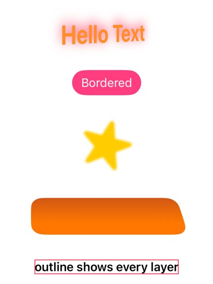

# Layers of any SwiftUI view

## `.tuneLayers(_:where:)` / `.dumpLayers(_:)` — iOS

```swift
Text("Hello").tuneLayers([.rotationY: 35, .shadowOpacity: 1, .shadowRadius: 8], where: .text)
Button("Go") {}.buttonStyle(.borderedProminent).tuneLayers([.filters: .filters([.colorHueRotate(2.2)])])
Image(systemName: "star.fill").tuneLayers([.blendMode: .blend(.difference)], where: .shape)
Text("Hi").tuneLayers([.contents: .image(UIImage(named: "photo")!)], where: .text)
VStack { … }.tuneLayers(.outline, where: .all)      // pink border on every layer
VStack { … }.dumpLayers("layers.txt")                 // what is there, and which targets match
```



On iOS 27 SwiftUI draws most primitives into bare CALayers without a UIView
(`Text("Hello").bone(into:)` → `_UIHostingView<Text>` › `CGDrawingLayer (layer)`): text and button
labels are `CGDrawingLayer` bitmaps, SF Symbols and filled shapes `ColorShapeLayer`, gradient fills
`GradientLayer`; glass keeps real views. Every one of them takes:

- **`LayerProperty`:** opacity, hidden, cornerRadius, masksToBounds, backgroundColor, border, shadow,
  3D transform about the centre (rotation, rotationX/Y + perspective, scale, translation – composed
  with SwiftUI's own), `blendMode` (22 Core Animation blend modes), `filters`, `contents` (replace the
  bitmap), `contentsGravity`; `.raw([...])` for any other key or key path.
- **`BoneFilter`:** gaussianBlur, colorMatrix, colorInvert, colorSaturate, colorHueRotate,
  colorBrightness, colorContrast, colorMonochrome, multiplyColor, luminanceToAlpha;
  `.raw(type, inputs)` for any other `kCAFilter…` type. All verified on a Text layer in the iOS 27
  simulator; they are added after SwiftUI's own filters.
- **`LayerTarget`:** `.leaves` (default – every drawn element), `.text`, `.shape`, `.gradient`,
  `.glass`, `.all`, `.className("…")`, `.custom`, combined with `||`.

Layers are SwiftUI's choice – it may merge or recreate them – so targets are layer kinds and values
are re-applied a few times per second. Text stays a bitmap: you can filter, warp, mask or replace it,
not edit glyphs.

The [inspector](inspector.md#layers) edits any layer you tap and gives the matching `.tuneLayers`
line. The demo shows all of it when launched with `-layers`.
