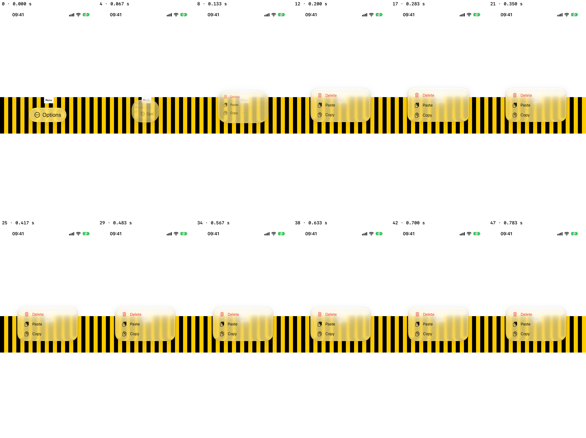
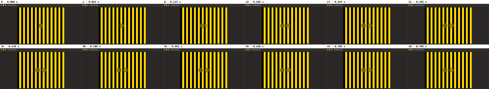

# Timeline and morphs

Pause, slow down and step the app's animations – the Liquid Glass morphs included – record a take
and scrub it, or dump its values.


## Timeline bar

Open it from the inspector's pick hint (**Timeline**), or with `.morphTimeline()` on any view:

```swift
Menu { Button("Copy") {} } label: { Label("Options", systemImage: "ellipsis.circle") }
    .buttonStyle(.glass)
    .morphTimeline()            // or .morphTimeline(speed: 0.1)
```

- **⏸** freezes everything. The glass stays live: the drop in the bar inspects or tunes it
  mid-morph, and 3D works too.
- **⏭** advances one 60 Hz frame.
- The **speed** button cycles 1× ½ ¼ ⅒ 1⁄20.
- **⏺** records a take: a spring only runs forward, so scrubbing is over a take. It steps the
  animation frame by frame, captures the screen after each step and stops once the morph has
  settled; the slider then scrubs the take both ways. **Save** writes a contact sheet
  (`timeline-take.png`, simulator only).



Pause first, then trigger the animation. On a device the screen reads back black, so a take keeps
system snapshot views (glass included, scrubbed instantly).

## On macOS

The inspector's **Timeline** opens a Mac bar too (`BoneMacTimeline.swift`), with ⏸, the speed
button, ⏺ and the take slider; `.morphTimeline()`, `.morphScrubber()` and `.dumpMorph` stay iOS-only.
The Mac works differently underneath: there are no AnimationKit ticks and no CAAnimations in a glass
morph – SwiftUI computes every frame itself, in the app window hosting view's `-layout`, at the
current time.

- **⏸** skips that `-layout`: the window holds its frame, and the glass in it stays live for the
  inspector. SwiftUI's clock keeps running underneath, so ▶ jumps to where the animation is by then,
  and there is no ⏭.
- **Speed** applies `Animation.speed` to every transaction under `.boneInspector()` (public API), so
  animations started after you set it run 2–20× slower, glass morphs included.
- **⏺** arms. The take starts when the window first differs from how it looked when armed, then
  captures the window once per 1/60 s of animation (wall time × speed) until it settles. At 1×
  that is as fast as ScreenCaptureKit allows (about 50 fps), so slow down first. The panel is left
  out of the frames (`sharingType = .none`). **Save** writes `timeline-take.png`.



On macOS 27 (`captures/mac-timeline-test.txt`), ⏸ held a `glassEffectID` morph, at 1/20 the shrinking
glass had moved 6 of its 40 pt after a second, and a take at 1/20 recorded the next morph in 49
frames (0.785 s of animation) over 18.7 s.

## `.morphScrubber()`

```swift
Menu { Button("Copy") {} } label: { Label("Options", systemImage: "ellipsis.circle") }
    .buttonStyle(.glass)
    .morphScrubber()
```

No steps at all: 1.2 s after launch it runs the modified control's primary action
(`performPrimaryAction()` – a glass Menu opens). The morph that starts is caught on its first frame
(the clock pauses on the very tick its manager wakes up or registers new animations), recorded frame
by frame to its end, and a 0.0–1.0 scrubber appears. **Again** waits for the next one;
`.morphScrubber(trigger: false)` waits for a tap instead (a finger on the app arms the clock).

Frame 0 – 0.0 on the scrubber – is the screen captured just before the morph (the untouched button):
the first frame the clock catches is already a little way in.

## `.dumpMorph(_:)`

```swift
Menu { … } label: { … }
    .buttonStyle(.glass)
    .dumpMorph("menu-morph.csv")
```

`.morphScrubber()` that also writes the morph's animated values, frame by frame, to a CSV in long
format:

```
frame,time,progress,layer,key,component,value
0,0.000000,0.0000,blob 1,bounds,height,235.486702
```

The values are read from the `CAPresentationModifier`s through which AnimationKit hands the morph to
the render server: the blob's `bounds` and `position` springing out, its `cornerRadii` (four
CGSizes: size1…size4), the lensing layer's `filters.displacementMap.inputAmount` and
`filters.gaussianBlur.inputRadius`, and the lens container's `sublayerTransform` (m11…m44).

## How the clock works (iOS)

The morphs are not CAAnimations – `layer.speed` does nothing to them. AnimationKit's
`LiquidMorphAnimation` and the other in-process animations are advanced inside the app by
`InProcessAnimationManager` (two instances, one on the main thread) from `-displayLinkFire:`, each
tick by `deltaTime = timestamp − time`. `BoneAnimationClock` swizzles that method and rewrites
`time` before each tick, so a tick advances by the clock's step: nothing while paused, exactly one
frame when stepping, and, when slowed down, whole 60 Hz frames every few ticks. That is stop-motion,
because parts of a morph are smoothed per tick: fed a tiny step every tick they still run at close
to full speed.

At pause every manager is caught up, and a manager waking while paused still gets each step, so the
two halves of a morph stay in step. Scaling Core Animation time as well is opt-in
(`timeline.scalesLayerTime`): slowing the window layer time down makes UIKit finish a morph at once.

The demo's first row is a glass `Menu` with the timeline (`-menu` shows only it). More detail, with
diagrams: [Bone internals – the AnimationKit clock](internals/bone-internals.md#6-motion-the-animationkit-clock).
