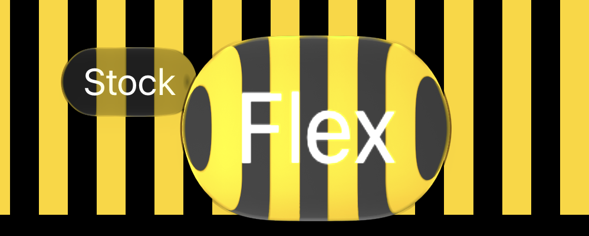
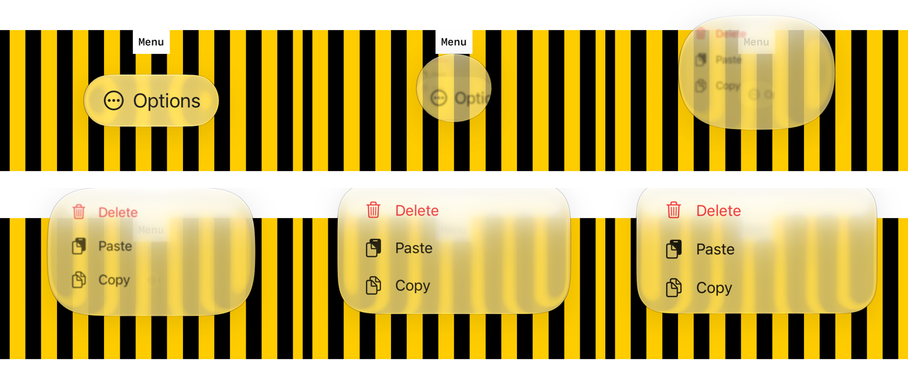
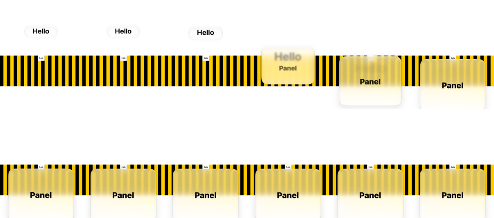

# Bone.swift


Bone looks underneath SwiftUI. It dumps the UIKit views behind any SwiftUI view, and it reads,
tunes, freezes, records and re-drives the system's own Liquid Glass – in place, not a
reimplementation.

<p align="center">
  
  <br><sub>The system's own glass button, stretched 6× by <code>.glassFlex</code> while dragged – stock on the left. <a href="Bone-27/docs/glass-stretch.md">Glass stretch</a></sub>
</p>

> **Research / simulator use only.** Bone uses private classes, selectors, ivars and Core
> Animation keys. Never ship it in an App Store build; names change between OS releases.
> Bone compiles only in **Debug** builds (empty in Release), so wrap your Bone calls in `#if DEBUG`.

## Get started

Add the Swift package – in Xcode, File ▸ Add Package Dependencies… with
`https://github.com/filipvabrousek/Bone`, branch `main` – and `import Bone`. Or copy every file in
[`library/`](library) into a folder of your project and add them to all targets.

```swift
List {
    Text("Bone")
}
.bone(into: "output.txt")
```

The hierarchy is written to `output.txt` and shown as an overlay you can expand to see layers,
sublayers and superclasses.


## A look

<table>
  <tr>
    <td width="50%"><br><sub>The glass <code>Menu</code> morph, paused and stepped frame by frame. <a href="Bone-27/docs/timeline.md">Timeline and morphs</a></sub></td>
    <td width="50%"><br><sub>Apple's own glass morph between any two views: <code>.liquidMorph</code>. <a href="Bone-27/docs/liquid-morph.md">Liquid morph</a></sub></td>
  </tr>
  <tr>
    <td width="50%" align="center"><br><sub>One glass button, four <code>.tune</code> settings. <a href="Bone-27/docs/glass-tuning.md">Glass tuning</a></sub></td>
    <td width="50%" align="center"><br><sub>3D, glow, blur and colour filters on the layers of any view: <code>.tuneLayers</code>. <a href="Bone-27/docs/layers.md">Layers</a></sub></td>
  </tr>
</table>

## What's in it

| Modifier | What it does | Docs |
|---|---|---|
| `.bone(into:)` | UIKit hierarchy behind a SwiftUI view → overlay + text/JSON dump (iOS, macOS, visionOS, watchOS) | [Hierarchy dumps](Bone-27/docs/hierarchy.md) |
| `.bone3D(into:)` · `.bone3DFrom(_:)` | the hierarchy as a 3D tree (visionOS) | [Hierarchy dumps](Bone-27/docs/hierarchy.md) |
| `.tune(_:)` | override any Liquid Glass parameter, presets, JSON hot reload | [Glass tuning](Bone-27/docs/glass-tuning.md) |
| `.dumpGlass(_:)` · `.dumpShaders(_:)` | glass inputs and the glass shaders' own uniforms | [Glass tuning](Bone-27/docs/glass-tuning.md) |
| `.probeGlass(_:)` | which glass inputs really change the pixels | [Glass tuning](Bone-27/docs/glass-tuning.md) |
| `.boneInspector()` | tap any glass or layer and edit it live; 3D exploded view | [Inspector and 3D](Bone-27/docs/inspector.md) |
| `.tuneLayers(_:where:)` · `.dumpLayers(_:)` | filters, blend modes, transforms on the layers of any view | [Layers](Bone-27/docs/layers.md) |
| `.morphTimeline()` · `.morphScrubber()` · `.dumpMorph(_:)` | pause, step, scrub and dump the Liquid Glass morphs | [Timeline and morphs](Bone-27/docs/timeline.md) |
| `.liquidMorph(to:isPresented:)` | Apple's glass morph between any two views | [Liquid morph](Bone-27/docs/liquid-morph.md) |
| `.glassFlex(stretch:follow:)` | the glass button's press and drag stretch, much further | [Glass stretch](Bone-27/docs/glass-stretch.md) |

## Platforms

| | iOS | watchOS | visionOS | macOS |
|---|:-:|:-:|:-:|:-:|
| Hierarchy dump `.bone(into:)` | ✓ | ✓ | ✓ | ✓ |
| 3D hierarchy `.bone3D` · `.bone3DFrom` | | | ✓ | |
| Liquid Glass `.tune` · `.dumpGlass` | ✓ | ✓ | | ✓ |
| `.tune(file:)` · `.dumpGlass(full: true)` | ✓ | | | ✓ |
| `.dumpLayers` | ✓ | ✓ | | ✓ |
| `.tuneLayers` · `.dumpShaders` | ✓ | | | ✓ |
| `.probeGlass` | ✓ | | | ✓ |
| `.boneInspector()` | ✓ | | | ✓ |
| 3D exploded view (in the inspector) | ✓ | | | |
| Timeline bar (in the inspector) | ✓ | | | ✓ |
| `.morphTimeline` · `.morphScrubber` · `.dumpMorph` · `.liquidMorph` · `.glassFlex` | ✓ | | | |

Built with Xcode 27; tested on iOS 27 (simulator and iPhone 14 Pro), watchOS 27 (simulator), visionOS 27 and macOS. Details in [Getting started](Bone-27/docs/getting-started.md#platforms).

## Documentation

- [Tests](Bone-27/Tests/BoneTests): `swift test`, or `Bone-27/Tests/run.sh` for every platform.
- [Guides](Bone-27/docs/index.md) – one page per topic, with examples, results and how each part works.
- [Getting started](Bone-27/docs/getting-started.md) – demo launch arguments, where files land.
- [Changelog](library/CHANGELOG.md) – what changed, by date, back to the first release in 2024.
- [Bone internals and novelty](Bone-27/docs/internals/bone-internals.md) – every mechanism at the
  level of layers, ivars and setters, with diagrams, and what is new compared with published work.
